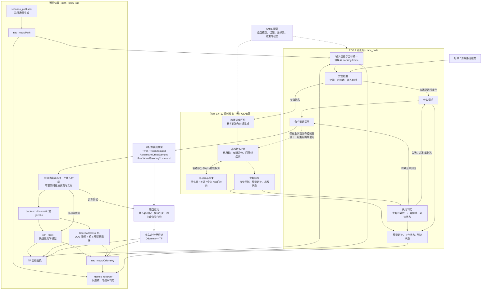

# 可移植 MPC 路径跟踪（ROS 2 Humble）

面向 Ubuntu 22.04 / ROS 2 Humble，支持阿克曼、差速、全向和前后轴独立四轮转向底盘。C++17 控制核心只使用标准库，不依赖 ROS、Eigen 或外部优化器；ROS 适配层单独负责通信、坐标变换与安全状态。ROS 构建默认包含 `ackermann_msgs` 和四轮转向自定义消息，不再需要可选构建开关。

> 这是运动学路径跟踪器，不是避障规划器或安全认证控制器。不包含碰撞约束或倒车规划。仓库提供独立的 `sim/path_follow_sim` 与可选 `sim/path_follow_gazebo`：前者是轻量运动学仿真，后者驱动 Gazebo Classic 11 中的真实轮/转向关节。Gazebo 可用于物理闭环开发，但不能替代实车验证；上车前必须验证转向符号、制动距离、定位、通信延迟和底盘自身的命令看门狗。

## 1. 架构



- [controller.hpp](include/path_follow_mpc/controller.hpp)：公共数据结构与控制接口。
- [controller.cpp](src/controller.cpp)：路径预处理、参考生成、模型积分及优化。
- [mpc_node.cpp](src/mpc_node.cpp)：ROS 2 接口及失效停车。
- [mpc.yaml](config/mpc.yaml)：完整参数。
- [tracking.launch.xml](launch/tracking.launch.xml)：启动入口，支持配置文件与命名空间。
- [test_controller.cpp](test/test_controller.cpp)：无 ROS 的运动学、约束和闭环仿真测试。
- [test_ros_adapter.cpp](test/test_ros_adapter.cpp)：真实 ROS 发布订阅、TF 和服务测试。
- [FourWheelSteeringCommand.idl](msg/FourWheelSteeringCommand.idl)：前后轴原生控制消息。
- [path_follow_sim 仿真包](../sim/path_follow_sim/README.md)：运动学与 Gazebo 物理闭环测试工具。

### 模型与命令语义

状态为 `[x, y, yaw]`，速度均在底盘本体系，单位采用 m、s、rad：

| `chassis`             | 优化控制量                      | 运动学                                                                   | 特性                                                      |
| ----------------------- | ------------------------------- | ------------------------------------------------------------------------ | --------------------------------------------------------- |
| `ackermann`           | `vx, steering`                | `yaw_rate = vx * tan(steering) / wheelbase`                            | 单轨模型、前进、不支持原地转向                            |
| `differential`        | `vx, yaw_rate`                | `x_dot = vx*cos(yaw), y_dot = vx*sin(yaw)`                             | 前进、可原地转向                                          |
| `omnidirectional`     | `vx, vy, yaw_rate`            | `x_dot = vx*cos(yaw)-vy*sin(yaw)`，`y_dot = vx*sin(yaw)+vy*cos(yaw)` | 可横移、可负向本体速度                                    |
| `four_wheel_steering` | `vx, front_angle, rear_angle` | `yaw_rate = vx*(tan(front)-tan(rear))/(lf+lr)`                         | 前后轴独立转向，可反相转弯/同相蟹行，前进、不支持原地转向 |

`Control.turn` 在阿克曼/四轮转向模型中是**前轴等效转角**，其他模型中是角速度。
`Control.rear_turn` 仅在四轮转向中表示后轴等效转角；`Control.vy` 仅在全向模型中作为独立控制量。其他模型的无效控制字段必须为零。
`Twist.angular.z` **始终是角速度**，绝不能在底盘驱动中直接当作转角！
阿克曼使用 `Twist` 时，驱动需按轴距反算转角并处理零速；若希望保留低速/零速转角命令，应选择原生 `AckermannDriveStamped` 输出。

### 四轮转向：参考点与推导

这里的“四轮转向”是**前轴左右轮合并为一个等效轮，后轴同理**，优化前、后轴两个独立转角；并非四个车轮的独立舵角/轮速控制。轮距、左右轮阿克曼补偿及驱动轮转速分配由底盘驱动负责。

设参考点在两轴之间，距离前轴 `lf=front_axle_distance`，距离后轴 `lr=rear_axle_distance`。默认 `lf=lr=0.325 m`，即两轴中点。`L=lf+lr` 为四轮转向轴距，**此模型不使用 `limits.wheelbase`**。车身 y 向左，前后轴向左转角均为正，分别记作 `df`、`dr`。无侧滑条件为：

```text
前轴：vy + lf * w = vx * tan(df)
后轴：vy - lr * w = vx * tan(dr)

联立得：
w  = vx * (tan(df) - tan(dr)) / L
vy = vx * (lr * tan(df) + lf * tan(dr)) / L

x_dot   = vx*cos(yaw) - vy*sin(yaw)
y_dot   = vx*sin(yaw) + vy*cos(yaw)
yaw_dot = w
```

`vx` 是**参考点的本体纵向分量**，不是车轮速度，也不是参考点合速度。实际合速度是 `hypot(vx, vy)`；若驱动使用合速度或轮速，必须换算后再执行。

- `df=dr`：`w=0`，车身保持朝向斜向平移，即蟹行。
- `df=-dr` 且 `lf=lr`：`vy=0`，反相转弯，同样的前转角比仅前轮转向有更小转弯半径。
- `dr=0`：仅前轮转向。但参考点在轴间而不是后轴上，因此 `vy=lr*w`，不能直接套用后轴中心位姿积分。
- `vx=0`：`vy=w=0`，无论转角是多少都不能原地旋转。有限转角（小于 90°）也不能实现全向底盘式的纯横移。

全向和四轮转向模型会插值路径点中的车身 yaw，而不是强制其等于路径切向。想要沿斜线蟹行，应保持各点 yaw 不变；想沿曲线转弯，可以提供随曲线变化的 yaw。路径方向与车身朝向的差必须在转向能力范围内，不能把任意全向路径直接给四轮转向执行。

### MPC 方法

采用非线性单次射击：每个预测步用恒定本体速度的解析 SE(2) 积分，最小化：

```text
sum(位置误差² * position + wrap(航向误差)² * heading
    + 速度参考误差² * velocity
    + (实际横速² + 前转向量² + 后转角²) * effort
    + 控制增量² * smoothness)
```

最后一步的位置/航向项再乘以 `terminal`。有限差分计算梯度，回溯线搜索、逐步投影保证每个预测控制量满足速度和变化率边界。每轮比较参考种子与移位热启动，执行最优序列的第一项。

路径按弧长插值，不要求等距；相邻重复位置合并，保留后一个姿态。初次全路径最近点定位，之后仅在当前进度前方 `progress_search_distance` 范围匹配，进度单调。路径交叉点初次匹配可能有歧义，应由上层提供当前应跟随的路径段。发生大距离重定位或机器人被搬动后，应重发路径。

阿克曼和差速模型以线段切向作为中间参考航向，以末点姿态作为终点航向；全向和四轮转向模型插值输入姿态。四轮转向会由期望速度和朝向变化反解前后轴前馈转角，再经过约束投影与优化修正。终点附近按剩余弧长降参考速度。到达判定同时要求剩余弧长、位置和航向落入容差；到达后输出零速并锁存完成状态。

这是有约束的局部数值优化，不保证全局最优，也不保证每次迭代收敛。`valid=true` 表示获得有限、可行解，`converged` 单独报告代价改善容差是否达到；非收敛解通过状态话题显式报告。`mpc.cost_tolerance` 对应绝对代价改善量，不是梯度范数。求解复杂度约为 `O(max_iterations * horizon²)`。

## 2. 构建与启动

在本仓库根目录：

```bash
source /opt/ros/humble/setup.bash
colcon build --base-paths mpc sim
source install/setup.bash

ros2 launch path_follow_mpc tracking.launch.xml
# 指定自己的配置（建议复制默认文件后修改）：
ros2 launch path_follow_mpc tracking.launch.xml \
  config:=/absolute/path/robot_mpc.yaml namespace:=robot1
```

上面的 `tracking.launch.xml` **只启动 MPC 节点，不会启动仿真器或实车驱动**。下方分别说明如何选择并启动仿真测试或实车测试；每次只连接一个执行后端。

### 开发与增量构建速查

日常开发直接用 ROS 2 原生构建工具增量编译即可，不需要手动清空工作区：

```bash
source /opt/ros/humble/setup.bash
colcon build --base-paths mpc sim
source install/setup.bash
```

工作区有 `mpc/` 和 `sim/` 两个源码目录，因此在仓库根目录加 `--base-paths mpc sim`，让 colcon 搜索这两个位置；不需要额外指定构建目录、包名和 CMake 参数。Gazebo 后端需要先安装其系统依赖。仅修改代码后通常执行：**重新 build → 重新 source → 重启节点**。只构建控制器时可用 `colcon build --base-paths mpc sim --packages-up-to path_follow_mpc`。

| 你改动的内容                                                          | 最小建议动作                                                                                 |
| --------------------------------------------------------------------- | -------------------------------------------------------------------------------------------- |
| `src/*.cpp`、`include/*.hpp`、`config/*.yaml`、`launch/*.xml` | `colcon build` 后重新 `source`，重启节点                                                 |
| 新增/修改消息（如 `msg/*.idl`）                                     | `colcon build`（同包依赖会自动重建）后重新 `source`                                      |
| `CMakeLists.txt` / `package.xml`                                  | 重新 `colcon build`；若依赖变化，先 `rosdep install --from-paths mpc --ignore-src -r -y` |
| 只改参数值想快速试验                                                  | 复制默认 YAML，启动时用 `config:=/absolute/path/xxx.yaml` 指定                             |

如果执行过多个构建目录，请保证测试时使用与运行一致的 install 空间，避免“编译的是新代码，运行的是旧环境”。

### 使用与调试指引（上车前优先看）

#### A. 仿真测试：Gazebo 物理仿真或快速运动学仿真

仿真工具与 MPC 分包维护。首次使用需安装 Gazebo Classic 11 和 ROS 插件（系统上已安装可跳过）：

```bash
sudo apt install gazebo libgazebo-dev ros-humble-gazebo-ros-pkgs ros-humble-ackermann-msgs
source /opt/ros/humble/setup.bash
```

在仓库根目录构建 `mpc` 与 `sim` 下的包（MPC、仿真工具和 Gazebo 轮关节插件）：

```bash
colcon build --base-paths mpc sim
source install/setup.bash
```

默认 `backend:=gazebo`，所以普通启动命令现在会打开 Gazebo GUI。它启动 Gazebo ODE 世界、生成四轮机器人、接通物理驱动插件，并启动 MPC、路径场景与指标记录：

```bash
# 默认：Gazebo GUI + 阿克曼底盘 + S 弯；测试完成后保留 Gazebo 窗口
ros2 launch path_follow_sim sim.launch.py \
  chassis:=ackermann scenario:=s_curve

# Gazebo 四轮转向变道/蟹行
ros2 launch path_follow_sim sim.launch.py \
  chassis:=four_wheel_steering scenario:=lane_change keep_heading:=true

# 结果在默认目录；summary.json 的 passed 表示是否通过
cat /tmp/path_follow_sim/summary.json
ros2 run path_follow_sim plot_result /tmp/path_follow_sim
```

默认测试完成后 Gazebo 保持运行，便于观察最终机器人状态；用 `Ctrl+C` 关闭。批量回归时加 `exit_on_finish:=true` 可在结束后自动关闭。无图形桌面或仅需快速算法回归时，显式选择轻量运动学后端：

```bash
ros2 launch path_follow_sim sim.launch.py \
  backend:=kinematic chassis:=ackermann scenario:=s_curve
```

该后端直接积分运动学，耗时短，适合迭代和 CI；Gazebo 后端有碰撞接触、轮胎摩擦、转向/驱动关节力矩和动力学延迟，仿真时钟运行更慢。Gazebo 生成的是本包的参数化机器人 SDF，而不是直接导入 `~/.gazebo` 模型；`sdf_to_params` 可以从现有模型估算几何值，再作为 launch 参数使用。两种后端话题接口一致。

`sim.launch.py` 默认 `launch_controller:=true`，自动启动本项目 MPC。测试**其他算法**时加 `launch_controller:=false`，另开终端启动自己的节点，订阅 `plan`、`odom` 并向 `cmd_vel`（或所选消息类型）发布命令。支持的路径场景有 `line|arc|s_curve|circle|figure8|lane_change`。Gazebo 物理参数（轮距、轮半径、力矩、轮级转向速度、命令超时等）见 `sim/path_follow_sim/config/sim.yaml` 中的 `gazebo` 项。完整参数和接口见 [仿真包说明](../sim/path_follow_sim/README.md)。

Gazebo 模型使用四个独立舵轮模拟全向底盘（不是麦克纳姆轮模型）；差速模型使用左右驱动轮及自由球形支撑。Gazebo 仍是近似模型，不含真实轮胎参数、悬架、传感器噪声模型或车辆安全认证，不能替代实车测试。

#### B. 实车测试：接入真实里程计与底盘驱动

实车流程不启动 `path_follow_sim`，也不启动任何仿真节点。只构建 MPC：

```bash
source /opt/ros/humble/setup.bash
colcon build --base-paths mpc sim --packages-up-to path_follow_mpc
source install/setup.bash
```

1. 先启动真实底盘驱动和定位/里程计节点，确认它们发布有效的 `odom`、`odom -> base_link` TF，并确认驱动订阅命令话题。参数和话题应按实际底盘在一份独立 YAML 中配置；不要直接假定默认轴距、参考点或驱动消息类型适用于你的车辆。
2. 复制 [mpc.yaml](config/mpc.yaml) 为车辆专用配置，设置真实的 `chassis`、`topics.*`、`frames.*`、`output.type`、轴距及四轮转向前/后轴距离、限速和安全参数。实车 `use_sim_time` 必须为 `false`；确认 `enabled` 的启动策略，首次联调建议设为 `false`。
3. 确认车轮离地或车辆处于可安全停车状态后，启动 MPC。下面只启动控制节点，不会自动启动驱动、定位或路径规划：

```bash
ros2 launch path_follow_mpc tracking.launch.xml \
  config:=/absolute/path/robot_mpc.yaml
```

4. 检查 `ros2 node info /mpc_tracker`、`ros2 topic hz /odom`、`ros2 topic echo /mpc/status`、`ros2 run tf2_ros tf2_echo odom base_link`。若以 `enabled: false` 启动，确认安全后调用启用服务；启用会清除任务，之后还需由规划器重新发布路径：

```bash
ros2 service call /mpc_tracker/enable std_srvs/srv/SetBool '{data: true}'
```

5. 确认低速、急停、命令超时停车和转向正负方向，再逐步提高速度。底盘必须有独立命令看门狗和急停；MPC 发布零速不能替代硬件安全措施。停止测试时先安全停车，再按系统流程停止 MPC 与底盘节点。

**严禁同时运行仿真和实车控制到同一套命令话题。** ROS 2 不会自动区分“仿真命令”和“实车命令”；若两个订阅者同时连接，实车驱动可能收到仿真测试的路径跟踪命令。

#### 两种测试共用的调试命令

常用观测命令：

```bash
source install/setup.bash
ros2 node info /mpc_tracker
ros2 param list /mpc_tracker
ros2 param get /mpc_tracker chassis
ros2 topic echo /mpc/status
ros2 topic hz /odom
ros2 topic echo /cmd_vel
ros2 run tf2_ros tf2_echo odom base_link
```

典型调试流程：

1. 先确认坐标与语义：`base_link` 是否就是控制参考点；阿克曼应为后轴中心，四轮转向应为 `lf/lr` 定义点。
2. 用低速小场景验证符号：`target_speed=0.2`，先直线再大半径圆弧。
3. 看状态话题再改权重：`mpc/status` 会给出停车或降级原因（如 TF 失败、里程计过期、未使能、未收敛）。
4. 需要可视化时，订阅 `topics.prediction` 在 RViz 对照路径与实际里程计。
5. 记录复现包时，建议同时录 `plan/odom/cmd_vel/mpc/status/mpc/prediction`：

```bash
ros2 bag record /plan /odom /cmd_vel /mpc/status /mpc/prediction
```

实车联调前检查清单：

- [ ] 底盘驱动已实现独立命令超时停车与急停；不要把本节点当作唯一安全链路。
- [ ] 驱动明确区分“角速度”和“转角”（`Twist.angular.z` 永远是角速度）。
- [ ] 若使用四轮转向，驱动已把前后轴等效角分配到左右轮，不把纵向速度直接当四轮同速。
- [ ] 实际里程计时间戳单调有效；`use_sim_time` 在全系统一致。
- [ ] 路径姿态与底盘能力匹配（阿克曼/四轮转向不能原地补末端朝向）。
- [ ] 低速架空测试通过后再落地，逐步提高 `target_speed`。

相对话题名随命名空间解析；以 `/` 开头的话题名为绝对话题。TF frame 名不会自动添加命名空间。参数为启动时只读，改 YAML 后重启；`use_sim_time` 是 ROS 自带参数。通过只读参数避免运行中切换模型/话题但只更新一半接口。运行中启停请使用服务。

### 原生阿克曼输出

`ackermann_msgs` 已成为 ROS 适配层的标准依赖，构建时总会编译、测试该输出。原来的 `MPC_ENABLE_ACKERMANN_MSGS` 开关已移除。默认配置仍使用 `twist` 以保持现有接口兼容；原生输出修改配置中的两项即可：

```yaml
chassis: ackermann
output:
  type: ackermann
```

原生消息使用 `drive.speed`（m/s）和 `drive.steering_angle`（rad），其他字段为零（按消息约定表示不请求额外加速度/转角速率限制）；实际离散变化率由控制核心限制。时间戳为发布时间，`frame_id=frames.base`。同一个话题不能同时运行订阅 Twist 和 Ackermann 消息的底盘驱动。

### 原生四轮转向输出

复制 [mpc.yaml](config/mpc.yaml)，保留其他参数，修改如下项后用 `config:=/absolute/path/your.yaml` 启动：

```yaml
chassis: four_wheel_steering
output:
  type: four_wheel_steering
limits:
  front_axle_distance: 0.325
  rear_axle_distance: 0.325
  max_steering: 0.55
  max_rear_steering: 0.55
  max_steering_rate: 0.8
  max_rear_steering_rate: 0.8
```

上述是 `ros__parameters` 内的局部片段，不是完整 ROS 参数文件；替换对应键，不要添加重复的 `limits` 段。

消息类型为 `path_follow_mpc/msg/FourWheelSteeringCommand`：

| 字段                      | 单位     | 含义                    |
| ------------------------- | -------- | ----------------------- |
| `header.stamp`          | ROS 时间 | 发布时间                |
| `header.frame_id`       | 字符串   | 底盘控制参考系          |
| `longitudinal_velocity` | m/s      | 参考点的本体 x 方向速度 |
| `front_steering_angle`  | rad      | 前轴等效转角，左转为正  |
| `rear_steering_angle`   | rad      | 后轴等效转角，左转为正  |

消息以 ROS 2 原生 IDL 定义，使用 rosidl 生成 C/C++/Python 类型；发布订阅方式与 `.msg` 相同。采用 IDL 是为了避开 Humble 的 `.msg`→IDL 转换工具读取中文构建路径时的兼容问题，不需要移动本项目。Humble 的 `ros2 interface show` 仅按 `.msg/.srv/.action` 查找，不能查看这个仅以 IDL 定义的类型；可使用下列 Python 命令查看字段，消息本身的发布订阅不受影响。

```bash
source build/install/setup.bash
python3 -c 'from path_follow_mpc.msg import FourWheelSteeringCommand as M; print(M.get_fields_and_field_types())'
ros2 topic echo /cmd_vel path_follow_mpc/msg/FourWheelSteeringCommand
```

四轮转向也可选择 `output.type: twist` 或 `twist_stamped`。此时 `linear.y` 会正确包含由转角计算出的横向速度；`angular.z` 为角速度。驱动若要反解角度，在 `vx>0` 时可用 `atan2(vy+lf*w,vx)`、`atan2(vy-lr*w,vx)`；零速时转角不可由 Twist 唯一恢复，因此原生消息是推荐接口。四轮转向不能选择 `output.type: ackermann`，否则启动报错，防止后轴命令被静默丢弃。

## 3. 接口契约

| 配置项 / 服务           | 默认名称                    | 类型                      | 说明                                 |
| ----------------------- | --------------------------- | ------------------------- | ------------------------------------ |
| `topics.path`         | `plan`                    | `nav_msgs/msg/Path`     | 新消息替换任务，空路径取消           |
| `topics.odometry`     | `odom`                    | `nav_msgs/msg/Odometry` | 有效时间戳的底盘位姿                 |
| `topics.command`      | `cmd_vel`                 | 由 `output.type` 决定   | 本体坐标命令，发布深度 1             |
| `topics.prediction`   | `mpc/prediction`          | `nav_msgs/msg/Path`     | 预测轨迹，在 tracking 坐标系         |
| `topics.status`       | `mpc/status`              | `std_msgs/msg/String`   | 工作状态与错误原因，transient-local  |
| `topics.goal_reached` | `mpc/goal_reached`        | `std_msgs/msg/Bool`     | 完成锁存，新路径/取消/启停时复位     |
| `~/enable`            | `/mpc_tracker/enable`     | `std_srvs/srv/SetBool`  | 禁用时停车清任务；启用后必须重发路径 |
| `~/clear_path`        | `/mpc_tracker/clear_path` | `std_srvs/srv/Empty`    | 停车并清任务                         |

```bash
ros2 service call /mpc_tracker/enable std_srvs/srv/SetBool '{data: false}'
ros2 service call /mpc_tracker/enable std_srvs/srv/SetBool '{data: true}'
ros2 service call /mpc_tracker/clear_path std_srvs/srv/Empty '{}'
ros2 topic echo /mpc/status
```

### 坐标、姿态与时间

- `Path.header.frame_id` 必须非空。各 `PoseStamped.header.frame_id` 可以为空，否则必须与路径总帧一致。统一使用路径头时间戳做一次 TF 查询，忽略各路径点的单独时间戳，保证同一快照。
- `Odometry.header.frame_id` 必须非空，`child_frame_id` 必须等于 `frames.base`。里程计位姿表达的是底盘控制参考点；不要传入未经外参校正的传感器位姿。阿克曼参考点应为后轴中心；四轮转向应为 `lf/lr` 定义的轴间参考点（默认中点）。路径位置也必须是同一参考点的期望轨迹。
- 路径和里程计可以来自不同帧；适配层将二者变换至 `frames.tracking`。TF 在输入时间戳查询，路径零时间戳表示最新 TF。路径变换后冻结在 tracking 帧，不会每周期重新变换；该帧应是稳定的 `odom` 或 `map`，不能是运动的 `base_link`。
- 位置和四元数必须有限；四元数不能全零，允许非单位四元数并归一化提取 yaw。所有模型仅使用二维位姿，忽略 z/roll/pitch。即便只跟踪位置，也应提供有效四元数（例如 `w: 1.0`）。
- 里程计必须有非零、不过期、不超前的时间戳；不能只重复发送旧戳以绕过看门狗。里程计 QoS 默认 best-effort / volatile / depth 1，兼容常见传感器发布者。
- `safety.path_timeout=0` 时路径持续有效且允许零时间戳；大于零时同时检查消息时间与接收时间，路径必须具有有效非零时间戳。
- 路径 QoS 默认 reliable / volatile / depth 1。若启用 `qos.path_transient_local`，发布端也必须支持 transient-local；注意该模式会在订阅时接受缓存的旧路径，应结合时间有效性和使能策略使用。
- 计算周期使用 steady/wall time，消息有效性使用 ROS time 加接收时的 steady time 双重检查。仿真中需统一配置 `use_sim_time`；时间倒退将清除任务，要求新路径和新里程计。

可向已经有里程计输入的节点发布一条直线路径（默认允许路径零时间戳）：

```bash
ros2 topic pub --once /plan nav_msgs/msg/Path \
  "{header: {frame_id: odom}, poses: [
    {pose: {position: {x: 0.0, y: 0.0}, orientation: {w: 1.0}}},
    {pose: {position: {x: 3.0, y: 0.0}, orientation: {w: 1.0}}}
  ]}"
```

实际路径必须根据当前车辆位置生成，不应直接在实车上盲目执行示例。

## 4. 参数与适配

所有参数均在 [mpc.yaml](config/mpc.yaml) 列全：

| 参数组                                                        | 含义 / 单位                                                                      |
| ------------------------------------------------------------- | -------------------------------------------------------------------------------- |
| `chassis`                                                   | `ackermann` / `differential` / `omnidirectional` / `four_wheel_steering` |
| `frames.tracking`, `frames.base`                          | 优化全局参考系、底盘控制参考系                                                   |
| `topics.*`, `output.type`, `qos.*`                      | 接口名、消息类型和订阅 QoS                                                       |
| `mpc.horizon`                                               | 预测步数 `[2,100]`；预测时长约 `horizon * dt`                                |
| `mpc.dt`                                                    | s；也是实际定时器周期，不单独设置不一致的控制频率                                |
| `mpc.max_iterations`                                        | 每次求解最大迭代数 `[1,1000]`                                                  |
| `mpc.cost_tolerance`                                        | 正数；一次接受步的绝对代价改善停止阈值                                           |
| `mpc.progress_search_distance`                              | m；初始化后前向匹配搜索范围                                                      |
| `limits.wheelbase`                                          | m；阿克曼轴距                                                                    |
| `limits.front_axle_distance`, `limits.rear_axle_distance` | m；四轮转向参考点到前/后轴的正距离，其和为轴距                                   |
| `limits.target_speed`                                       | m/s；沿路径的期望速度，必须正且不超过 `max_vx`                                 |
| `limits.max_vx`, `limits.max_vy`                          | m/s；本体系各方向速度边界                                                        |
| `limits.max_yaw_rate`, `limits.max_steering`              | rad/s、rad；角速度和转角边界                                                     |
| `limits.max_rear_steering`                                  | rad；四轮转向后轴转角边界，必须在 `(0,pi/2)`                                   |
| `limits.max_acceleration`                                   | m/s²；`vx` 变化率                                                             |
| `limits.max_lateral_acceleration`                           | m/s²；全向 `vy` 变化率，**不是**阿克曼向心加速度约束                    |
| `limits.max_yaw_acceleration`, `limits.max_steering_rate` | rad/s²、rad/s                                                                   |
| `limits.max_rear_steering_rate`                             | rad/s；四轮转向后轴转角变化率                                                    |
| `weights.*`                                                 | 代价权重；effort/smoothness 可为零，其余必须为正                                 |
| `goal.position_tolerance`, `goal.yaw_tolerance`           | m、rad                                                                           |
| `safety.odom_timeout`                                       | s；必须正，建议大于正常里程计周期的 3 倍                                         |
| `safety.path_timeout`                                       | s；零表示任务不自动过期                                                          |
| `safety.transform_timeout`                                  | s；TF 等待上限，必须非负且小于 `dt`                                            |
| `safety.future_stamp_tolerance`                             | s；允许时间戳超前量，非负                                                        |
| `safety.max_path_points`                                    | 单次路径最大点数，避免无界处理                                                   |
| `enabled`                                                   | 初始使能；上电需人工确认时设为 false                                             |

阿克曼为同时保证转角和角速度限制，使用保守的固定转角上限：

```text
min(max_steering, atan(max_yaw_rate * wheelbase / max_vx))
```

四轮转向为保证任意允许的两轴组合同时满足 `max_yaw_rate` 和 `max_vy`，采用：

```text
L = front_axle_distance + rear_axle_distance
t = min(max_yaw_rate * L / (2 * max_vx), max_vy / max_vx)
front_limit = min(max_steering,      atan(t))
rear_limit  = min(max_rear_steering, atan(t))
```

因为 `|tan(df)-tan(dr)| <= 2*t`，角速度不会超限；横速是两个有界正权重项的加权平均再乘 `vx`，因此也不会超限。这是保守的可行矩形边界，不会利用所有低速转向能力；不是前后角固定比例，两轴仍独立优化。

固定边界避免速度变化引发转角边界瞬间收缩，但在低速时不会使用全部潜在转角。变化率约束基于上次**已发布命令**，不是测得加速度；里程计 twist 不参与当前模型。四轮转向限制纵速变化率、两轴角速率和推导出的横速/角速度，**不承诺横向加速度或角加速度上限**；`max_lateral_acceleration` 仅全向适用，`max_yaw_acceleration` 仅差速/全向适用。正常跟踪的第一条命令从零开始限斜率，上电时应确保车辆静止。故障、取消、到达时的零速和两轴回零是紧急停止请求，**有意绕过**正常加速度/转角速率约束；驱动必须负责执行器物理限制与安全制动。

### 推荐调试顺序

1. 先核对 frame、轴距、控制参考点和消息语义，确保 x 前、y 左、yaw 逆时针为正。
2. 低速 `target_speed=0.2`，使用直线路径，检查转向符号；再测试半径大于最小转弯半径的圆弧。
3. `horizon * dt` 先取 1.5–3 s；需要更高控制频率时减小 `dt`，同时留意计算量。
4. 横向跟踪弱可提高 position，航向误差大可提高 heading；命令抖动提高 smoothness。
5. 全向/四轮转向保朝向平移时，在路径各点给相同朝向；四轮转向蟹行角须可达，不能测试 90° 纯侧移。
6. 非全向路径应平滑、前向、曲率可行。阿克曼/四轮转向末点朝向必须可由前向运动到达，不支持到点后原地对齐。不满足时不会虚报到达，应由上层规划修正。

## 5. 安全行为与边界

- 无路径、禁用、取消、到达、里程计超时/无效、TF 失败、数值异常均发布零速。
- 空路径、无效新路径、路径 TF 失败会取消原任务，不会继续执行旧任务；无效输入会记录明确原因。
- 里程计/里程计 TF 暂时恢复后，若原任务仍有效且使能，则自动恢复；需要人工确认的系统应在故障后调用禁用服务。
- 过期路径被清除，重新使能和 ROS 时钟倒退也要求新任务；`goal_reached` 不因重复控制周期复位。
- TF 与求解耗时合计若达到 `dt`，该次解作废并停车；求解后还复查里程计有效性。
- SIGINT/SIGTERM 正常退出时尝试发布最后零速；进程崩溃、断电、DDS 丢包、系统调度停顿时不能保证送达。**底盘必须自带命令超时停车、急停和独立安全回路。**
- 本节点不进行障碍检测、速度障碍物约束、轮速分配、打滑补偿或动力学安全判定。不要直接替代完整导航系统的安全控制链路。

## 6. 验证

```bash
colcon test --base-paths mpc sim --packages-select path_follow_mpc \
  --event-handlers console_direct+
colcon test-result --test-result-base build/path_follow_mpc --verbose

# 或直接 CMake / CTest
cmake -S mpc -B build/mpc -DCMAKE_BUILD_TYPE=Release
cmake --build build/mpc -j2
ctest --test-dir build/mpc --output-on-failure
build/mpc/test_mpc
```

核心测试覆盖：配置/非有限值校验、重复点和单点路径、角度跨 ±π、精确运动学、四底盘直线/圆弧闭环、全向横移、差速原地转向、输出边界与变化率、预测输出形状。八个路径闭环从 0.35 m 横向偏差开始，要求 220 步内达到默认 0.08 m / 0.15 rad 容差，初始 20 步后横向 RMS < 0.12 m，并打印实际误差与求解耗时。另验证四轮转向的前后轴无侧滑方程、同相/反相/仅前轮转向、非对称参考点、蟹行保持朝向、较严格的横速/角速度/后转角/后转角速率约束。

ROS 集成测试使用独立 ROS domain 和 localhost，覆盖：四种输出消息、原生消息的前后轴转角和时间戳、四轮转向 Twist 蟹行横速、模型与消息类型不匹配拒绝、TF 成功/失败、里程计失联与旧时间戳、取消/启停、无效路径、到达锁存、路径过期。原生阿克曼和四轮转向输出均实际进行发布订阅与停车验证。此处核心/ROS 测试不替代 Gazebo 物理回归或实车测试；Gazebo 测试命令见 [仿真包文档](../sim/path_follow_sim/README.md#测试)。

## 7. 不依赖 ROS 的移植

```bash
cmake -S mpc -B build/mpc-core \
  -DMPC_BUILD_ROS2=OFF -DCMAKE_BUILD_TYPE=Release
cmake --build build/mpc-core -j2
ctest --test-dir build/mpc-core --output-on-failure
```

可直接 `add_subdirectory(mpc)` 并链接 `mpc_core`，或安装后通过
`find_package(path_follow_mpc CONFIG REQUIRED)` 链接 `path_follow_mpc::mpc_core`。
使用 `add_subdirectory` 时需先将 `MPC_BUILD_ROS2` 设为 OFF。

```cpp
#include <path_follow_mpc/controller.hpp>

using namespace path_follow_mpc;

Config config;
config.chassis = Chassis::Ackermann;
config.wheelbase = 0.65;
config.dt = 0.1;
Controller controller(config);  // Invalid configuration throws.
controller.set_path({{0, 0, 0}, {3, 0, 0}});

Pose measured_pose{0, 0, 0};
Control last_applied{};
Result result = controller.compute(measured_pose, last_applied);
if (!result.valid || result.goal_reached) {
  // Send a stop request and report result.message to your application.
} else {
  // Adapt vx/vy/turn/rear_turn to the actuator interface, then retain the sent command.
  last_applied = result.command;
}
```

`Controller` 有状态且不是线程安全的；同一实例的路径更新和求解必须串行。实际循环要按 `dt` 调用，提供最新同帧位姿，将实际发送的上次控制量传回；该量必须在模型约束内。硬件改写/裁剪了命令时不能仍回传未发送的值。自行处理看门狗、求解超时和状态发布。路径/配置无效会抛出 `std::invalid_argument`，`compute` 无路径/状态无效/数值失败通过 `Result.valid=false` 和 `message` 报告，不能忽略。

适配 CAN、串口或其他中间件时只需替换 ROS 层；若增加其他运动学模型，需要同步扩展 `Chassis`、运动学、控制限幅、参考生成、命令适配及测试，不能仅修改输出消息。

## 8. 面向初学者的代码阅读与二次开发

### 8.1 为什么 MPC 不是“算一次就一路执行”

例如 `dt=0.1`、`horizon=20`：每隔 0.1 s，控制器假想未来 2 s 的 20 条控制命令，模拟其轨迹并计算代价，然后不断调整命令，让误差减小。**只发送第一条**；下个周期根据新位置再次求解。这样才能修正扰动，而不是依赖理想模型开环驾驶。

只会根据当前误差直接求转角的控制器通常不需要预测序列；本项目的 MPC 同时考虑未来轨迹、速度、转角和相邻步变化量。但它仍依赖局部优化和路径可行性，不会凭空解决不可达的目标。

### 8.2 推荐阅读顺序

1. 先读 [mpc.yaml](config/mpc.yaml)：每项均注明含义、单位、有效模型和主要限制。不要一开始修改优化器。
2. 再读 [controller.hpp](include/path_follow_mpc/controller.hpp)：分清 `Pose`、`Control`、`Config`、`Result`，特别注意 `turn` 在不同模型中的单位。
3. 在 [controller.cpp](src/controller.cpp) 中顺序阅读：
   - `yaw_rate` / `lateral_velocity`：将底盘控制量变成同一参考点的本体速度。
   - `integrate`：把本体速度转换为下一个固定坐标系位姿。
   - `set_path` / `update_progress` / `sample`：清理路径、找到当前进度、插值得到未来目标。
   - `references`：按速度和剩余距离生成参考序列；四轮转向额外计算转角前馈。
   - `constrain` / `project`：同时保证绝对边界和相邻步变化率。边界作用在**整条预测序列**。
   - `evaluate`：模拟每步并累计代价。位置误差、航向误差、速度误差不是同一量纲，权重用来平衡它们。
   - `compute`：校验、到达判定、种子/热启动、中央差分、回溯线搜索、结果有限性检查和第一项输出。
4. 最后读 [mpc_node.cpp](src/mpc_node.cpp)：这里不应重新实现运动学。它把消息转换成核心数据，执行安全检查，再把控制量转换成底盘消息。
5. 运行并修改 [test_controller.cpp](test/test_controller.cpp) 中的小仿真，先证明自己的模型/参数可工作，再接实车。

### 8.3 一个周期的数据流

```text
on_path: 总帧/时间/四元数校验 -> 一次 TF -> set_path -> 清除上次任务进度和热启动
on_odom: 子帧/时间/四元数校验 -> 保存最新输入及 steady 接收时刻
on_timer:
  使能、时间倒退、里程计、路径有效性检查
  -> 按里程计时间戳做 TF 得到测量位姿
  -> compute(measured_pose, last_published_control)
  -> 检查计算超时/输入是否在求解期间过期
  -> 发布预测轨迹及第一条命令；或到达后发零速
```

ROS 回调使用单线程执行器，核心无需锁；如果后续改为多线程执行器，必须保证对同一控制器的路径修改、清理和求解互斥。`previous_` 是“上次发送值”，不是“优化器希望执行但实际未发送的值”。

### 8.4 常见问题定位

| 现象                         | 优先排查                                                                          |
| ---------------------------- | --------------------------------------------------------------------------------- |
| 一直零速                     | 先看 `mpc/status`；检查 enabled、路径、里程计频率/时间戳及 TF，不要直接增大权重 |
| 一发路径就报姿态错误         | 检查四元数是否全零；无旋转应设 `orientation.w=1.0`                              |
| 转向方向反了                 | 核对弧度/角度、左右符号、驱动是否把角速度当转角                                   |
| 四轮转向反相转弯却异常侧滑   | 检查前/后轴转角符号、参考点及 `lf/lr`，并确认驱动做了左右轮分配                 |
| 蟹行时车身被强制转向路径方向 | 检查 chassis 是否四轮转向，以及路径 yaw 是否真的保持不变                          |
| 靠近终点不完成               | 同时检查位置和 yaw；四轮转向/阿克曼无法原地补末端航向，可能需要重新规划           |
| 新模型输出无后轮命令         | 不要使用 AckermannDriveStamped 承载四轮转向；选自定义消息                         |
| 控制偶尔变零                 | 查看是否求解超过 dt、TF 等待或里程计过期；减小 horizon/迭代量前先测耗时           |

### 8.5 扩展接口而不破坏核心

若底盘使用 CAN/串口，建议单独写驱动节点订阅原生控制消息，将前后轴等效角转换为真实执行器目标，统一处理符号、单位和限位。先用录制或打印代替发电机指令验证字段，随后低速架空测试，再落地测试。底盘驱动必须设置命令超时和急停；本项目持续发零速并不能覆盖进程崩溃。

如果驱动需要各轮轮速，需要额外知道轮距、轮半径和驱动形式；不要把 `longitudinal_velocity` 直接当作四个轮子的相同滚动速度。修改消息字段后重新 colcon 构建并重新 source 环境；其他 ROS 包通过 `<depend>path_follow_mpc</depend>` 和 `find_package(path_follow_mpc REQUIRED)` 使用本包消息。
