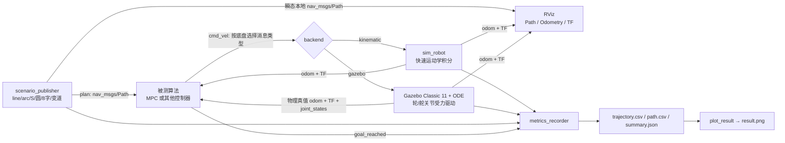

# path_follow_sim：通用路径跟踪仿真

通过 ROS 话题验证 MPC 或其他“位姿反馈 + 速度/转角指令”算法。提供两种可切换后端：

* **Gazebo Classic 11（默认）**：ODE 物理引擎、接触/摩擦、独立轮驱动与转向关节，启动时可显示 Gazebo GUI。
* **kinematic**：快速运动学积分模型，便于算法调参、单元回归和无图形环境使用。

仿真 launch 默认同时打开 Gazebo 与 RViz。Gazebo 显示物理机器人和世界；RViz 显示参考路径、Odometry 历史和 TF。算法接口不随后端改变：输入 `plan`、`odom`，输出配置的底盘命令。仿真不等同于实车安全验证。

## 架构



| 组件 | 作用 |
|---|---|
| `sim_robot` | 快速运动学后端；支持四种底盘、一阶滞后、命令看门狗与里程计噪声 |
| `path_follow_gazebo` | C++ `gazebo_ros` ModelPlugin，只通过关节电机驱动车轮/转向，物理引擎决定机身运动；发布仿真时间、Odometry、TF 和 `joint_states` |
| `scenario_publisher` / `path_publisher` | 发布标准 `nav_msgs/Path`；默认 reliable + transient-local，晚启动的 Pure Pursuit 等订阅者也可收到最近路径；固定 yaw 支持蟹行路径 |
| RViz | 显示 `plan` 路径、`odom` 里程计历史和 TF；Gazebo 窗口显示机器人实体 |
| `metrics_recorder` | 记录横向/航向/终点误差，输出 CSV 和通过判定 JSON |
| `sdf_to_params` | 只读现有 SDF，启发式估算车轮几何；不会自动修改/加载用户模型 |
| `plot_result` | 绘制参考/实际轨迹、误差和机体速度 |

## 安装和构建

Ubuntu 22.04 + ROS 2 Humble 的 Gazebo Classic 依赖（已装可跳过）：

```bash
sudo apt install gazebo libgazebo-dev ros-humble-gazebo-ros-pkgs
source /opt/ros/humble/setup.bash
```

在仓库根目录执行：

```bash
colcon build --base-paths mpc sim
source install/setup.bash
```

`sim/path_follow_gazebo` 是物理插件包。若只用 kinematic 后端且本机无 Gazebo，可单独构建：

```bash
colcon build --base-paths mpc sim --packages-up-to path_follow_sim
```

## Gazebo 物理仿真（默认）

```bash
# 默认 backend=gazebo、gui=true、阿克曼底盘、S 弯场景
ros2 launch path_follow_sim sim.launch.py

# 其他底盘
ros2 launch path_follow_sim sim.launch.py chassis:=differential scenario:=arc
ros2 launch path_follow_sim sim.launch.py chassis:=omnidirectional scenario:=lane_change keep_heading:=true
ros2 launch path_follow_sim sim.launch.py chassis:=four_wheel_steering scenario:=lane_change keep_heading:=true

# 完成后默认保持 Gazebo 和 RViz；无显示环境可分别关闭
ros2 launch path_follow_sim sim.launch.py gui:=false rviz:=false

# 测试完成后默认保留 Gazebo 与 launch，方便交互检查
ros2 launch path_follow_sim sim.launch.py exit_on_finish:=false

# 无桌面/SSH 的 headless 测试
ros2 launch path_follow_sim sim.launch.py gui:=false
```

默认场景结束或超时后保留 Gazebo 和 RViz，方便查看最终车辆姿态及跟踪结果；按 `Ctrl+C` 关闭。批量回归时指定 `exit_on_finish:=true` 自动退出。`gui:=false` 只关闭 Gazebo GUI，`rviz:=false` 只关闭 RViz；headless 测试请两个都设为 false。`rviz_config:=/path/to/view.rviz` 可指定自己的 RViz 布局。单独入口 `gazebo.launch.py` 也支持相同参数。

### Gazebo 底盘物理实现

仿真器从本包的 `tracking.world` 和生成的 SDF 创建机器人。它不会写入或覆盖 `~/.gazebo/models` 中的任何资源。

| chassis | 模型 |
|---|---|
| `ackermann` | 前双舵轮 + 后双驱动轮；控制参考点在后轴中心 |
| `differential` | 左右驱动轮 + 前后自由球形支撑 |
| `omnidirectional` | 四个独立驱动/转向模块（swerve），不是麦克纳姆轮模型 |
| `four_wheel_steering` | 前、后两轴各有左右舵轮，驱动和转角分别执行 |

插件只用 Gazebo 关节电机的速度/力矩接口控制轮关节，不直接设置机身世界位姿或速度。里程计来自刚体状态，`joint_states` 发布物理关节状态。物理后端限定 ODE；发现其他物理引擎会报错，不会假称支持。

默认 `cmd_type` 按底盘选择：阿克曼用 `ackermann_msgs/AckermannDriveStamped`，差速/全向用 `geometry_msgs/Twist`，四轮转向用 `path_follow_mpc/FourWheelSteeringCommand`。需要测试其他兼容输入时可显式设置 `cmd_type:=twist_stamped` 等。底盘模型和消息类型不匹配会拒绝启动。

Gazebo 本体参数位于 `config/sim.yaml` 的 `/**.ros__parameters.gazebo`：

| 参数 | 默认值 | 含义 |
|---|---:|---|
| `command_timeout` | 0.5 s | 无新命令后将轮电机目标清零 |
| `wheel_torque` | 8 N·m | 每个轮驱动关节最大力矩 |
| `steering_torque` | 10 N·m | 每个舵关节最大力矩 |
| `steering_rate` | 2 rad/s | 转向关节速度限制 |
| `max_speed` | 2 m/s | 输入机体 vx/vy 的物理驱动保护上限 |
| `max_yaw_rate` | 2 rad/s | 输入角速度保护上限 |
| `publish_rate` | 50 Hz | 仿真真值 odometry、TF、joint_states 频率 |

插件将非有限、超限、底盘不支持的命令置为停车并记录错误。命令超时清除驱动目标。真实 Gazebo 接触滑移、关节动力学和速度可能不同于算法模型；需按机器人质量、轮胎摩擦和电机上限调整这些参数。这里的轮胎摩擦仍为通用近似值。

## 快速运动学后端

它不启动 Gazebo，无 GUI，是可重复的理想化软件闭环测试：

```bash
ros2 launch path_follow_sim sim.launch.py \
  backend:=kinematic chassis:=ackermann scenario:=s_curve
ros2 launch path_follow_sim sim.launch.py \
  backend:=kinematic chassis:=four_wheel_steering \
  scenario:=lane_change keep_heading:=true
```

支持场景：`line`、`arc`、`s_curve`、`circle`、`figure8`、`lane_change`。通过 `sim_config:=/path/to/sim.yaml` 提供参数覆盖文件；launch 参数支持 `chassis`、`cmd_type`、几何参数、`track`、`wheel_radius`、`gui`、`world`、`scenario`、`keep_heading`、`launch_controller`、`mpc_config`、`output_dir`、`timeout`、`exit_on_finish`。

## 接入自己的算法

默认同时启动 MPC。设置 `launch_controller:=false`，由你自己的算法节点发布命令：

```bash
ros2 launch path_follow_sim sim.launch.py \
  backend:=gazebo launch_controller:=false chassis:=differential
```

被测节点订阅 `plan`（`nav_msgs/Path`）和 `odom`（`nav_msgs/Odometry`），向 `cmd_vel` 发布所选消息。修改 `config/sim.yaml` 的 `topics.*`、`frames.*` 并用 `sim_config:=` 指定。你的控制器完成任务时可发布 `std_msgs/Bool` 到 `mpc/goal_reached`；不发此话题时指标节点会在 `timeout` 结束测试。

实车流程不启动本仿真包。不要让 Gazebo 与实车驱动同时订阅同一个实际车辆命令话题。

## 单独给 Pure Pursuit 发布路径

测试 Pure Pursuit 或其他只需要 `nav_msgs/Path` 输入的控制器时，可独立运行路径发布器，不启动 MPC、Gazebo、RViz 或指标节点：

```bash
# 默认发布 S 弯到 /plan，坐标系 frame_id=odom
ros2 launch path_follow_sim publish_path.launch.py

# 直接发到你的 Pure Pursuit 输入话题，生成圆弧
ros2 launch path_follow_sim publish_path.launch.py \
  path_topic:=/pursuit/reference_path scenario:=arc radius:=4.0
```

可选场景为 `line`、`arc`、`s_curve`、`circle`、`figure8`、`lane_change`；还可设置 `frame`、`spacing`、`x0`、`y0`、`length`、`amplitude`、`keep_heading` 和 `heading`。发布消息是普通 `nav_msgs/msg/Path`，各 pose 带有效 yaw 四元数。

publisher 使用 reliable + transient-local QoS。独立 `publish_path.launch.py` 会等待至少一个订阅者连接后再发布一次，因此推荐**先启动 Pure Pursuit，再启动路径发布器**；默认 volatile 的 Pure Pursuit 订阅者也可可靠接到新发布的路径。路径只发布一次，不会周期重复重置控制器；发布节点需保持运行。若 Pure Pursuit 使用 transient-local QoS，即使晚于路径发布器启动也可收到保留的路径；volatile 订阅者无法接收它启动前已发布的历史样本。

启动你的 Pure Pursuit 时，将其 Path 输入 remap/参数设为同一个话题，例如 `/pursuit/reference_path`。本包不依赖某个特定 Pure Pursuit 实现，因此其命令输出话题和类型由你使用的控制器决定；要在本仿真闭环中测试，还需让它输出本包配置的 `cmd_vel` 类型，并设置 `launch_controller:=false`。

RViz 默认也订阅 `/plan`。使用自定义路径话题运行仿真时，`path_topic:=/pursuit/reference_path` 会同时更新路径发布器、MPC/指标订阅和 RViz 显示。

## 指标、图表与复位

结果默认写入 `/tmp/path_follow_sim`：

* `summary.json`：`passed`、最大/RMS 横向误差、终点误差、最大速度/角速度和结束原因。
* `trajectory.csv`：实际位姿、速度和误差。
* `path.csv`：参考轨迹。

```bash
cat /tmp/path_follow_sim/summary.json
ros2 run path_follow_sim plot_result /tmp/path_follow_sim
```

`plot_result` 默认写 `result.png`；加 `--show` 打开图窗。重新运行测试会覆盖对应输出文件。

## 使用已有 Gazebo 模型的几何

`sdf_to_params` 是辅助估算工具，不会自动实例化现有车辆：

```bash
ros2 run path_follow_sim sdf_to_params ~/.gazebo/models/cart_front_steer/model.sdf
# 示例估算：Ackermann 轴距 1.0 m、轮距 0.596 m、轮半径 0.15 m
ros2 launch path_follow_sim sim.launch.py \
  backend:=gazebo wheelbase:=1.0 track:=0.596 wheel_radius:=0.15
```

该后端使用生成的通用轮关节 SDF。现有 SDF 的关节名称、几何、参考点和 plugin 都可能不同，不能只设置模型路径就认为已完成适配；要直接加载特定模型，需为该模型核对关节名/轴向并添加兼容驱动插件。

## 测试

运动学/工具快速测试（不启动 Gazebo）：

```bash
cd sim/path_follow_sim
python3 -m pytest test/test_sim_core.py test/test_closed_loop.py -q
```

Gazebo 模型结构、四底盘物理闭环、关节运动及看门狗测试（启动真实 ODE 仿真）：

```bash
cd <仓库根目录>
source /opt/ros/humble/setup.bash
colcon build --base-paths mpc sim
source install/setup.bash
PATH_FOLLOW_TEST_GAZEBO=1 python3 -m pytest \
  sim/path_follow_sim/test/test_gazebo.py -v
```

Gazebo 回归使用 headless server 和专用 ROS domain，不需要交互 GUI；图形界面运行则用上面的 `ros2 launch` 命令。launch 测试检查生成的实体、插件确实加载、轨迹通过阈值、轮关节实际运动、零速转角保持以及停止/无效命令后的停车行为。

## 模型与安全边界

* Gazebo 是接触/刚体/关节物理仿真，不等于真实轮胎、悬架、传感器或认证级环境。
* Ackermann 约定控制参考点为后轴中心；4WS 和 swerve 使用前后轴间中点。自定义几何要保持仿真、控制器、路径和 odometry 的参考点一致。
* Gazebo 插件看门狗只用于测试，真实底盘仍需独立硬件/驱动看门狗、急停和限幅。
* 仿真结果中的 `passed` 只代表本配置、本路径、本阈值下通过，不能推断为实车安全或普遍性能保证。
