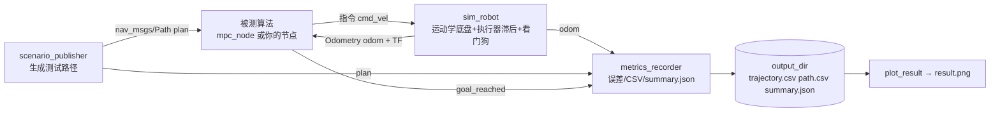

# path_follow_sim：通用轻量仿真工具

用于验证路径跟踪（及其他“位姿反馈 + 速度/转角指令”类）算法。与被测算法**只通过话题耦合**，
不依赖 `path_follow_mpc` 的任何代码（仅 `four_wheel_steering` 指令类型会导入其消息）。

## 1. 架构



| 组件 | 作用 |
|---|---|
| `sim_robot` | 订阅指令、积分位姿、发布 Odometry 与 `odom→base_link` TF；支持 4 种底盘、4 种指令类型、一阶执行器滞后、指令超时自动停车、里程计噪声、`~/reset` 服务 |
| `scenario_publisher` | 场景：`line arc s_curve circle figure8 lane_change`；`keep_heading` 固定朝向用于蟹行/全向测试；`~/publish` 服务可重发 |
| `metrics_recorder` | 横向误差、航向误差、终点误差、最大速度/角速度；按阈值判定通过 |
| `sdf_to_params` | 从 Gazebo SDF 估算轴距/轮距/轮半径并给出参数建议（只读，不改模型） |
| `plot_result` | 绘制轨迹、误差、速度曲线 |

## 2. 构建与运行

```bash
source /opt/ros/humble/setup.bash
colcon build --base-paths mpc sim --packages-select path_follow_mpc path_follow_sim
source install/setup.bash

ros2 launch path_follow_sim sim.launch.py chassis:=ackermann scenario:=s_curve
ros2 launch path_follow_sim sim.launch.py chassis:=four_wheel_steering scenario:=lane_change keep_heading:=true
ros2 run path_follow_sim plot_result /tmp/path_follow_sim
```

`sim.launch.py` 主要参数（`ros2 launch path_follow_sim sim.launch.py -s` 查看全部）：
`chassis`、`cmd_type`（空=按底盘默认）、`scenario`、`keep_heading`、`wheelbase`、
`front_axle_distance`、`rear_axle_distance`、`launch_controller`、`mpc_config`、`sim_config`、
`output_dir`、`timeout`、`exit_on_finish`。launch 会把底盘、指令类型与几何参数同时覆盖到仿真器和 MPC，保证一致。

## 3. 验证你自己的算法

```bash
ros2 launch path_follow_sim sim.launch.py launch_controller:=false chassis:=differential cmd_type:=twist
```

你的节点：订阅 `plan`(Path) 与 `odom`(Odometry)，向 `cmd_vel` 发布指令即可。话题名、坐标系在
[config/sim.yaml](config/sim.yaml) 中配置，若你的话题不同，用 launch 的 `sim_config:=` 传入自己的 YAML。
算法完成时发布 `std_msgs/Bool` 到 `topics.goal_reached`（置空则只靠超时结束）。

## 4. 使用 `~/.gazebo` 中的机器人模型

当前环境**未安装 Gazebo**，因此用运动学仿真验证算法；模型用于提取几何参数：

```bash
ros2 run path_follow_sim sdf_to_params ~/.gazebo/models/cart_front_steer/model.sdf
# cart_front_steer → ackermann, wheelbase=1.0, track=0.596, wheel_radius=0.15
ros2 launch path_follow_sim sim.launch.py wheelbase:=1.0 mpc_config:=<按该车限幅调整后的yaml>
```

注意：阿克曼控制参考点为后轴中心，若模型的 `base_link` 不在后轴，需要增加 TF 偏移。
若以后安装 `ros-humble-gazebo-ros-pkgs`，可保持算法侧话题不变，只把 `sim_robot` 换成 Gazebo 的驱动插件
（`scenario_publisher`、`metrics_recorder` 无需改动）——这是解耦设计的目的。该功能目前**未实现也未验证**。

## 5. 测试

```bash
cd sim/path_follow_sim && python3 -m pytest test -q   # 核心单测 + 4 种底盘闭环回归（约 90 s）
```

闭环结果读取 `output_dir/summary.json`：`passed`、`max_cross_track_m`、`rms_cross_track_m`、
`final_position_error_m` 等；阈值在 `limits.*`。launch 不传递子进程返回码，请以该文件为准。

## 6. 局限

* 运动学模型，无轮胎滑移、悬架、地形；`actuator_time_constant` 仅一阶滞后。
* 不含障碍物与传感器仿真。
* 默认 MPC 限幅下，阿克曼轴距 1.0 m 跑 `s_curve`（振幅 1 m）实测最大横向误差 0.35 m，超过默认 0.3 m 阈值
  而判失败——这是参数边界，可降低 `target_speed`、放宽 `limits.max_cross_track` 或换更缓的场景。
* 扩展场景：在 `scenarios.py` 的 `SCENARIOS` 注册函数即可。
